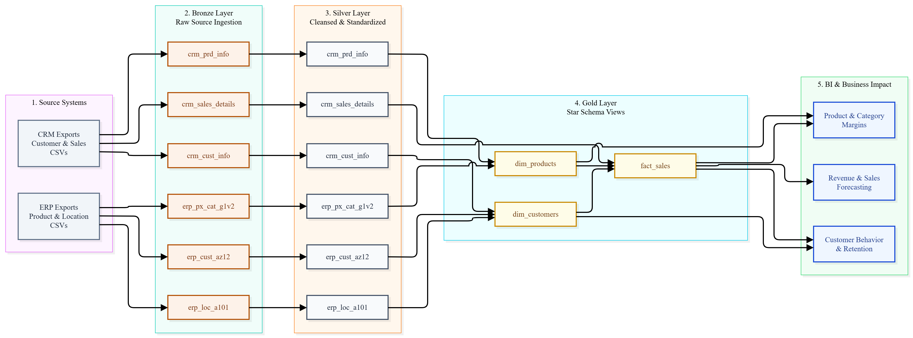
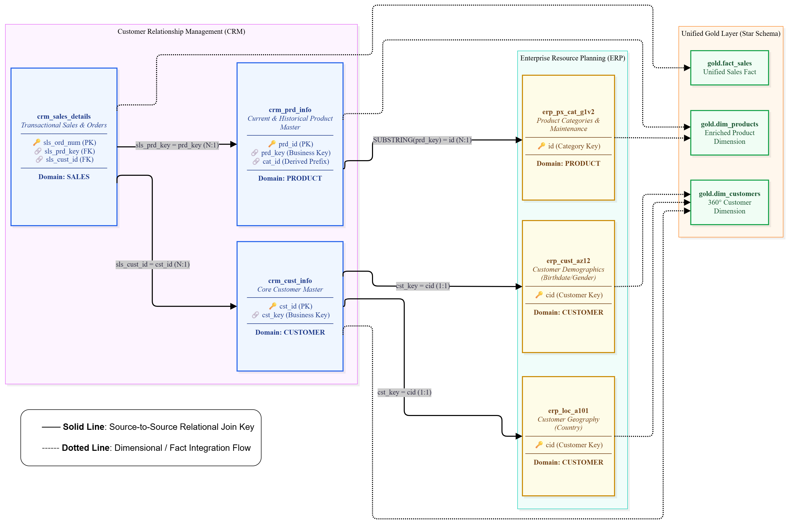

# Enterprise SQL Data Warehouse & Business Intelligence Solution

**Consolidating fragmented ERP and CRM sales data into a single, quality-assured source of truth for executive decision-making.**

Welcome to the **Data Warehouse & Analytics Solution** repository. This project demonstrates an end-to-end modern data warehousing implementation built on **SQL Server**, transforming raw operational data from disconnected systems into an analytics-ready star schema and actionable business intelligence.

Designed with an **enterprise engineering and Six Sigma quality-assurance mindset**, this solution bridges the gap between raw technical data pipelines and clear, stakeholder-ready reporting.

---

## 🎯 Business Problem & Value Delivered
Growing businesses often struggle with sales data trapped across separate **ERP** and **CRM** systems—leading to manual spreadsheet reporting, inconsistent metrics, and delayed decisions. 

This solution solves that bottleneck by:
* **Eliminating Data Silos:** Integrating ERP and CRM data into one unified analytical model.
* **Enforcing Data Quality:** Applying strict validation, cleansing, and standardization rules before data ever reaches business reports.
* **Accelerating Decision-Making:** Delivering structured SQL analytics across customer behavior, product performance, and revenue trends.
* **Bridging Business & Tech:** Providing clear architectural diagrams and non-technical data documentation so both executives and developers stay aligned.

---

## 🏗️ Solution Architecture & Scope

This warehouse follows the industry-standard **Medallion Architecture** to ensure traceability, data integrity, and maintainability:

1. **Bronze Layer (Raw Ingestion):** Automated ETL pipelines extract and load raw ERP and CRM source data (CSV) into SQL Server while preserving source fidelity.
2. **Silver Layer (Data Quality & Standardization):** Applies systematic data cleansing, deduplication, standardization, and business-rule validation to resolve source anomalies.
3. **Gold Layer (Business-Ready Star Schema):** Models cleansed data into intuitive **Fact and Dimension tables**, optimized for fast BI queries and executive dashboards.
4. **Analytics & Reporting Layer:** Delivers targeted SQL analytical queries answering core commercial questions:
   * **Customer Behavior:** Retention patterns, segmentation, and lifetime value drivers.
   * **Product Performance:** Top-performing SKUs, category margins, and slow-moving inventory.
   * **Sales Trends:** Period-over-period revenue growth, seasonality, and regional performance.
### End-to-End Data Lineage & Pipeline Flow

### Cross-System Data Integration & Entity Relationships

---

## 📋 Technical Specifications & Governance
* **Source Systems:** Multi-source integration consolidating **ERP** and **CRM** exports.
* **Data Quality & Root-Cause Cleansing:** Systematic resolution of missing values, formatting inconsistencies, and schema mismatches prior to analytical modeling.
* **Scope & Modeling:** Focused on current-state operational reporting using a clean, user-friendly dimensional model (Facts & Dimensions).
* **Stakeholder Documentation:** Includes visual architecture diagrams, data lineage flows, and a plain-language data catalog to support both business leaders and engineering teams.

---

## 🛠️ Tech Stack & Project Assets
* **Database & ETL:** Microsoft SQL Server, T-SQL, SQL Server Management Studio (SSMS) — *(see `/00_setup` for environment configuration)*
* **Architecture & Modeling:** draw.io (System Architecture, Data Flow & Entity-Relationship Diagrams)
* **Agile Delivery & Documentation:** Notion (Sprint backlog, phased execution plan, and stakeholder documentation)
* **Version Control:** Git & GitHub
* **Data Governance & Standards:** [Naming Conventions & Modeling Standards](docs/naming-conventions.md)
* **Requirements & Scope Blueprint:** [Project Requirements & Scope Specification](docs/project-requirements.md)

---

## 👤 About Me

I am a **Technical Delivery & Data Strategy Consultant** specializing in bridging the gap between business stakeholders and technical teams. 

With an **MSc in Systems Engineering**, graduate studies in **Informatics, Data-Driven & IT Management**, **Microsoft Azure Data Engineer (DP-203)** certification, and formal training in **Quality Control & Lean/Six Sigma**, I help organizations turn fragmented data and unclear requirements into structured, reliable business solutions.

Having worked across enterprise consulting (**Capgemini, Nagarro, Epical**) and high-precision industrial environments (**Volvo Cars**), I combine **people-first stakeholder facilitation** (requirements engineering, UML modeling, and Agile/Scrum delivery) with deep technical literacy in SQL, cloud data architectures, and analytics.

**How I Help Businesses:**
* **Stakeholder-to-Developer Translation:** Turning business goals into clear requirements, UML diagrams, and data models that developers can execute without guesswork.
* **Agile / Scrum Delivery for Data & AI Teams:** Bringing calm, predictable sprint structure to data engineering and analytics initiatives.
* **Data-Driven & Quality Process Advisory:** Helping SMEs eliminate reporting bottlenecks and improve data quality across products, services, and operations.

🌍 Based in Sweden | Working remotely with teams worldwide in **English, French, and Swedish**.  
📩 **Interested in bringing clarity to your data or streamlining an upcoming project?** Connect with me on [LinkedIn] (https://www.linkedin.com/in/josephdesirefotso) or reach out directly to discuss your goals.
